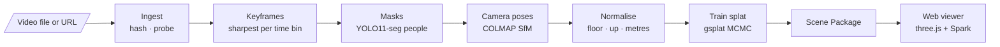

# CrimeSplat — Video Pipeline

**Turn crime-scene video into an explorable 3D reconstruction.**

CrimeSplat takes footage (body-cam, handheld/phone, YouTube/news, drone) and reconstructs the scene as a **3D Gaussian Splat** you can orbit in a web browser. You can click any surface to see the exact video frames that observed it, snap to a frame's original viewpoint to check the reconstruction against the evidence, and scrub a timeline that moves the camera wearer through the scene.

It's the video arm of the research project *Crime Scene Reconstruction using Scene Graphs*. It is independent of the project's text and image pipelines.

> **Status: v0.1, static-scene MVP.** The full pipeline runs end-to-end and is verified against a synthetic scene with known ground truth. It hasn't yet been tested on real footage. People tracking, evidence detection and event detection are planned (see [Roadmap](#roadmap)).

---

## What it does



| Stage | What happens |
|---|---|
| **Ingest** | Downloads (yt-dlp) or copies the video and records its SHA-256 (chain of custody) and metadata |
| **Keyframes** | Picks the sharpest frame in each time bin (variance of the Laplacian) |
| **Masks** | Segments people and vehicles so they don't become "ghosts" in the static scene |
| **Camera poses** | Structure-from-Motion: SIFT features, incremental mapping, bundle adjustment. Lens calibration comes from the video itself. |
| **Normalise** | Finds the floor (RANSAC over horizontal planes), aligns Y-up, and sets metric scale from the camera height |
| **Train** | Optimises a 3D Gaussian Splat with masked L1 + SSIM loss and a memory-capped MCMC strategy |
| **Package** | Writes a self-contained folder: splat, camera trajectory, thumbnails, sparse points with visibility, manifest with file hashes |

### Verified results (synthetic room, RTX 3050 Laptop 4 GB)

| Metric | Result |
|---|---|
| Keyframes registered | 105 / 105 |
| Camera trajectory error (ATE) | **4.3 mm** mean |
| Metric scale error | **1.5 %** |
| Gravity (up-vector) error | **0.46°** |
| Held-out view quality | **28.6 dB PSNR** |
| Training | 7,000 iterations in 7.7 min, 0.52 GiB peak VRAM |

---

## Quick start

**Requirements:** Linux or WSL2, an NVIDIA GPU with driver ≥ 550, `ffmpeg`, and Node.js (for the viewer). No CUDA toolkit is needed: all GPU code comes as prebuilt wheels.

```bash
# 1. Install everything and check the machine
bash scripts/setup.sh
```

```bash
# 2. Reconstruct a video
cd pipeline
uv run crimesplat init room01 --source ~/Videos/room01.mp4 --footage handheld
uv run crimesplat run room01
```

```bash
# 3. Open it in the viewer
uv run crimesplat publish-local room01
npm --prefix ../web run dev
```

Then open `http://localhost:5173/?scene=scenes/room01`.

### Try it without footage

A synthetic room with known camera poses checks the whole pipeline and reports its accuracy:

```bash
cd pipeline
uv run python tools/make_synthetic_video.py ../data/synthetic_room.mp4
uv run crimesplat init synth --source ../data/synthetic_room.mp4 --footage handheld
uv run crimesplat run synth
uv run python tools/eval_poses.py ../workspace/synth ../data/synthetic_room.gt.json
```

### CLI

| Command | Purpose |
|---|---|
| `crimesplat init <case> --source <file\|url> --footage <type>` | Create `cases/<case>.yaml` |
| `crimesplat run <case> [--profile P] [--until STAGE] [--force STAGE]` | Run stages. Unchanged stages are cached. |
| `crimesplat status <case>` | Show cached / stale / not-run stages |
| `crimesplat doctor` | Check GPU, CUDA kernels, COLMAP, ffmpeg; suggest a profile |
| `crimesplat publish-local <case>` | Copy the Scene Package into the viewer |

**Footage presets:** `handheld` (phones, default), `bodycam` (fisheye lens, chest height), `drone`, `news`.

**Compute profiles:**

| Profile | GPU | Training resolution | Max Gaussians | Iterations |
|---|---|---|---|---|
| `laptop-4gb` | RTX 3050-class | 960 px | 300 k | 7 k |
| `gpu-8gb` | RTX 4060/4070 | 1280 px | 800 k | 30 k |
| `gpu-24gb` | RTX 4090 | 1600 px | 2 M | 30 k |

Any setting can be overridden in the case file, e.g. `normalize.camera_height_m: 1.6`. See [pipeline/README.md](pipeline/README.md).

---

## Viewer

- **Explore:** drag to orbit, scroll to zoom, right-drag to pan.
- **Click any surface:** lists the frames that actually observed that spot, using COLMAP's feature tracks (so occlusion is handled), with a crosshair on each frame.
- **Snap to this view:** flies to the frame's original camera pose with matched field of view and overlays the source frame, to verify the reconstruction against the evidence.
- **Timeline:** play or scrub through the video. The orange capsule is the camera wearer: for body-cam footage, the officer's path *is* the camera path.

---

## Repository layout

```
crimesplat-video/
├── pipeline/            Python package `crimesplat`
│   ├── crimesplat/      CLI, config, workspace/cache, dataset, stages/
│   ├── configs/         footage presets and compute profiles
│   └── tools/           synthetic test-scene renderer, pose evaluator
├── web/                 Viewer (Vite + TypeScript + three.js + Spark)
├── docs/                Design docs, ADRs, research notes, runbook, build log
├── scripts/setup.sh     One-shot machine setup
├── cases/               Case configs (one YAML per reconstruction)
├── workspace/           Run outputs, per case and stage (git-ignored)
└── data/                Input videos (git-ignored)
```

## Tech stack

| Area | Technology |
|---|---|
| Gaussian Splatting | [gsplat](https://github.com/nerfstudio-project/gsplat) 1.5.3 (MCMC densification) on PyTorch 2.4.1 + CUDA 12.4 |
| Structure-from-Motion | [COLMAP](https://colmap.github.io/) via pycolmap 4.2.1 (incremental; GLOMAP global mapper optional) |
| Segmentation | Ultralytics YOLO11-seg |
| Video | ffmpeg, OpenCV, PySceneDetect, yt-dlp |
| Pipeline | Python 3.10, uv, pydantic, Typer |
| Viewer | three.js 0.187, [Spark](https://sparkjs.dev/) 2.4, Vite, TypeScript |

---

## Documentation

Start at [docs/README.md](docs/README.md).

| Read this | For |
|---|---|
| [00 Overview & requirements](docs/00-overview.md) | Problem, scope, functional and non-functional requirements |
| [01 Feasibility](docs/01-feasibility.md) | What footage works, and why camera type decides everything |
| [02 Architecture](docs/02-high-level-architecture.md) · [03 Data flow](docs/03-data-flow.md) · [04 Low-level design](docs/04-low-level-design.md) | System design |
| [05 Data model](docs/05-data-model.md) | Scene Package format |
| [08 Risks](docs/08-risks-and-blockers.md) · [09 Evaluation & ethics](docs/09-evaluation-and-ethics.md) | Research plan |
| [11 Build log & explainer](docs/11-build-log-and-explainer.md) | How v0.1 was built, with the theory behind every stage |
| [GPU runbook](docs/gpu-day-runbook.md) | Filming guidelines and the plan for full-quality runs |
| [4D Gaussian Splatting assessment](docs/research/4dgs-feasibility.md) | Why dynamic splats are a research extension, not the core |
| [Decision records](docs/decisions/) | ADR-0001 to ADR-0005 |

## Roadmap

| Phase | Scope | Status |
|---|---|---|
| 0–1 | Static-scene pipeline and viewer | ✅ v0.1 |
| — | Real-footage tests; full-quality runs on an RTX 40-series GPU | Next |
| 2 | People tracking and 3D lifting, evidence and event proposals with human review | Planned |
| 3 | Multi-camera CCTV, evaluation on staged scenes, user study | Planned |
| 4 | 4D event-clip experiments, SMPL body models | Research stretch |

Details: [docs/10-roadmap.md](docs/10-roadmap.md).

---

## Responsible use

This is an **academic research tool**. A reconstruction is an aid to understanding a scene, not a substitute for the original evidence, and the viewer's snap-to-frame overlay exists so every view can be checked against the source.

- Development and published results use **staged or consented footage**. Real case footage must not be published, hosted publicly or sent to third-party services without approval.
- No face recognition or identity inference. People are anonymous track IDs.
- AI-generated proposals (planned) are always labelled and require human confirmation.

See [docs/09-evaluation-and-ethics.md](docs/09-evaluation-and-ethics.md).

## Licensing of dependencies

The current pipeline's core (gsplat, COLMAP, three.js, Spark) is permissively licensed. Some components planned for later phases are **non-commercial**: SuperPoint weights, VGGT, MASt3R, SMPL, and the original Inria 3DGS code used by 4D-GS. Ultralytics YOLO is AGPL-3.0. These are fine for academic research but must be reviewed before any commercial use. See [docs/07-tech-stack.md](docs/07-tech-stack.md).
