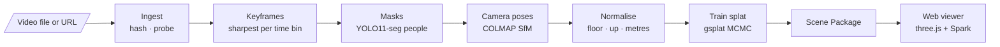

# CrimeSplat — Video Pipeline

**Turn crime-scene video into an explorable 3D reconstruction.**

CrimeSplat takes footage (body-cam, handheld/phone, YouTube/news, drone) and reconstructs the scene as a **3D Gaussian Splat** you can orbit in a web browser. You can click any surface to see the exact video frames that observed it, snap to a frame's original viewpoint to check the reconstruction against the evidence, and scrub a timeline that moves the camera wearer through the scene.

It's the video arm of the research project *Crime Scene Reconstruction using Scene Graphs*. It is independent of the project's text and image pipelines.

> **Status: v0.1, static-scene MVP.** The full pipeline runs end-to-end and is verified against a synthetic scene with known ground truth. It hasn't yet been tested on real footage. People tracking, evidence detection and event detection are planned (see [Roadmap](#roadmap)).

---

## What it does



| Stage | What happens |
|---|---|
| **Ingest** | Downloads (yt-dlp) or copies the video and records its SHA-256 (chain of custody) and metadata |
| **Keyframes** | Picks the sharpest frame in each time bin (variance of the Laplacian) |
| **Masks** | Segments people and vehicles so they don't become "ghosts" in the static scene |
| **Camera poses** | Structure-from-Motion: SIFT features, incremental mapping, bundle adjustment. Lens calibration comes from the video itself. |
| **Normalise** | Finds the floor (RANSAC over horizontal planes), aligns Y-up, and sets metric scale from the camera height |
| **Train** | Optimises a 3D Gaussian Splat with masked L1 + SSIM loss and a memory-capped MCMC strategy |
| **Package** | Writes a self-contained folder: splat, camera trajectory, thumbnails, sparse points with visibility, manifest with file hashes |

---

## Quick start

**Requirements:** Linux or WSL2, an NVIDIA GPU with driver ≥ 550, `ffmpeg`, and Node.js (for the viewer). No CUDA toolkit is needed: all GPU code comes as prebuilt wheels.

```bash
# 1. Install everything and check the machine
bash scripts/setup.sh
```

```bash
# 2. Reconstruct a video
cd pipeline
uv run crimesplat init room01 --source ~/Videos/room01.mp4 --footage handheld
uv run crimesplat run room01
```

```bash
# 3. Open it in the viewer
uv run crimesplat publish-local room01
npm --prefix ../web run dev
```

Then open `http://localhost:5173/?scene=scenes/room01`.

### Try it without footage

A synthetic room with known camera poses checks the whole pipeline and reports its accuracy:

```bash
cd pipeline
uv run python tools/make_synthetic_video.py ../data/synthetic_room.mp4
uv run crimesplat init synth --source ../data/synthetic_room.mp4 --footage handheld
uv run crimesplat run synth
uv run python tools/eval_poses.py ../workspace/synth ../data/synthetic_room.gt.json
```

### CLI

| Command | Purpose |
|---|---|
| `crimesplat init <case> --source <file\|url> --footage <type>` | Create `cases/<case>.yaml` |
| `crimesplat run <case> [--profile P] [--until STAGE] [--force STAGE]` | Run stages. Unchanged stages are cached. |
| `crimesplat status <case>` | Show cached / stale / not-run stages |
| `crimesplat doctor` | Check GPU, CUDA kernels, COLMAP, ffmpeg; suggest a profile |
| `crimesplat publish-local <case>` | Copy the Scene Package into the viewer |

**Footage presets:** `handheld` (phones, default), `bodycam` (fisheye lens, chest height), `drone`, `news`.

## Repository layout

```
crimesplat-video/
├── pipeline/            Python package `crimesplat`
│   ├── crimesplat/      CLI, config, workspace/cache, dataset, stages/
│   ├── configs/         footage presets and compute profiles
│   └── tools/           synthetic test-scene renderer, pose evaluator
├── web/                 Viewer (Vite + TypeScript + three.js + Spark)
├── docs/                Design docs, ADRs, research notes, runbook, build log
├── scripts/setup.sh     One-shot machine setup
├── cases/               Case configs (one YAML per reconstruction)
├── workspace/           Run outputs, per case and stage (git-ignored)
└── data/                Input videos (git-ignored)
```

## Tech stack

| Area | Technology |
|---|---|
| Gaussian Splatting | [gsplat](https://github.com/nerfstudio-project/gsplat) 1.5.3 (MCMC densification) on PyTorch 2.4.1 + CUDA 12.4 |
| Structure-from-Motion | [COLMAP](https://colmap.github.io/) via pycolmap 4.2.1 (incremental; GLOMAP global mapper optional) |
| Segmentation | Ultralytics YOLO11-seg |
| Video | ffmpeg, OpenCV, PySceneDetect, yt-dlp |
| Pipeline | Python 3.10, uv, pydantic, Typer |
| Viewer | three.js 0.187, [Spark](https://sparkjs.dev/) 2.4, Vite, TypeScript |
