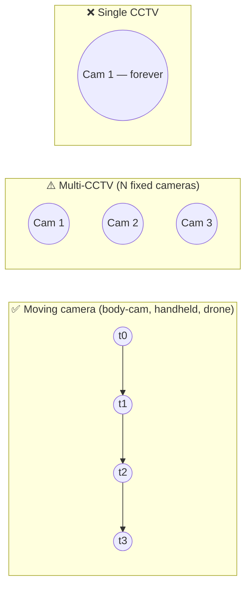

# 01 — Feasibility Study

This document answers *"can this actually be built, by us, on our hardware?"* for each requirement. It also states plainly what can't be built yet.

## 1. Summary verdict

| Capability | Feasibility | Notes |
|---|---|---|
| Static 3DGS from body-cam / handheld video | ✅ High | Well-established (COLMAP → 3DGS). Main enemies: motion blur, people in frame, fisheye. |
| Static 3DGS from YouTube / drone / news | ✅ High (drone) / ⚠️ Medium (edited news) | Edited videos need scene-cut splitting. Burned-in overlays need masking. |
| Static 3DGS from multi-camera CCTV | ⚠️ Medium–Low | Only N viewpoints (N = number of cameras), so it's a *sparse-view* problem. Needs feed-forward priors (MASt3R/VGGT) and gives lower quality. |
| Static 3DGS from a single fixed CCTV | ❌ Out of scope | No parallax. Only a "2.5D" depth-image pop-out is possible. |
| Removing moving people from the splat | ✅ High | Segmentation masks (SAM 2) applied in SfM and in the 3DGS loss. |
| Body-cam wearer trajectory | ✅ High | It's the camera trajectory itself, which SfM gives us for free. |
| Other actors' 3D positions over time | ✅ Medium–High | 2D tracking + ground-plane ray casting. Accurate to roughly 0.3–1 m depending on scale quality. |
| Actor 3D body pose (SMPL) | ⚠️ Medium | World-grounded HMR (WHAM / GVHMR) works but is fragile with occlusion and close-range body-cam views. "Could" priority. |
| Clickable evidence → source frames | ✅ High | Pure geometry once poses are known. |
| Automatic evidence and event detection | ⚠️ Medium | Open-vocabulary detectors and VLMs produce *candidates*. Precision isn't good enough to skip human review. |
| Metric scale | ⚠️ Medium | Monocular metric depth or known-size objects (doors ≈ 2.0 m). Expect ±5–15% error. |
| Full dynamic 4DGS | ❌ Deferred | Research-grade. Unreliable on in-the-wild handheld footage. Detailed review of 4D-GS and Dynamic 3D Gaussians: [research/4dgs-feasibility.md](research/4dgs-feasibility.md). |

**Conclusion:** the project is feasible as scoped (static scene + tracked actors, moving-camera footage first). The highest-risk items are (a) the **4 GB VRAM** budget and (b) **sparse-view multi-CCTV**. Both have planned mitigations below.

## 2. Why the camera type decides everything

3DGS (like all multi-view reconstruction) needs the same scene points to be seen from **different positions**. That parallax is what triangulates depth.

| Footage | Distinct viewpoints | Parallax | Implication |
|---|---|---|---|
| Body-cam walking through a house | Hundreds | Strong (when walking) / none (when only turning the head) | Standard pipeline. Pure-rotation segments must be detected. |
| Drone orbit (like the flight-7598 demo) | Hundreds | Strong | Ideal input. |
| Edited news footage | Many, but split across cuts and different shots | Varies | Split into shots, then try to register all shots together. Some shots won't register. |
| 3–6 CCTV cameras | 3–6 | Wide-baseline | Sparse-view reconstruction. Learned priors needed. Holes behind objects. |
| 1 CCTV camera | 1 | None | Can't produce real 3D. |

### 2.1 Body-cam specifics
- **Wearer = camera.** The officer's trajectory comes directly from the SfM camera poses. No detection is needed for them.
- **Head/torso rotation without translation** produces no parallax. Those frames still get poses (by registering them to the model), but they contribute little geometry.
- **Wide-angle / fisheye lenses** (often 120–170° FOV) must be modelled. COLMAP's `OPENCV_FISHEYE` camera model, followed by undistortion.
- **Motion blur and low light** are common. Frame selection must reject blurry frames (see [04-low-level-design.md](04-low-level-design.md) §3).
- **Released body-cam footage is often redacted** (blurred faces, black boxes) and has burned-in timestamps or watermarks. These must be masked so they don't become "geometry".

### 2.2 Multi-CCTV specifics
- Cameras are fixed, so each contributes **one pose**. Reconstruction quality is bounded by how much the views overlap.
- Wide-baseline matching between cameras with very different viewpoints often defeats SIFT. Feed-forward models (MASt3R, VGGT) handle this better.
- **Time sync** across feeds: CCTV DVR clocks drift. Sync via burned-in timestamps (OCR), audio, or a shared visual event (manual offset).
- **Mitigation for poor coverage:** let the user add a *survey walk-through* video of the same location (filmed later, e.g., a crime-scene unit walk-through). The CCTV cameras are then *localised* into that dense model, which turns a sparse-view problem into an easy one. This is how real deployments would work, and it's documented as the recommended CCTV workflow.

## 3. Hardware feasibility (RTX 3050 Laptop, 4 GB VRAM)

Measured machine: **NVIDIA GeForce RTX 3050 Laptop GPU, 4096 MiB VRAM**, 15 GiB system RAM, 16 CPU threads.

### 3.1 Per-stage memory estimates

| Stage | Typical VRAM | Fits in 4 GB? | Laptop strategy |
|---|---|---|---|
| Frame extraction / selection | CPU | ✅ | — |
| SAM 2 (hiera-tiny/small) video masking | 1.5–3 GB | ✅ | Use tiny model. Process in chunks. |
| YOLO11-s detection / tracking | < 1 GB | ✅ | — |
| COLMAP SIFT (GPU) + matching | 1–2 GB | ✅ | Or run on CPU (slower). |
| SuperPoint + LightGlue (hloc) | 1–2 GB | ✅ | Limit keypoints to 2048. |
| GLOMAP / COLMAP mapping | CPU + RAM | ✅ | 150–400 frames is fine. |
| **3DGS training (gsplat)** | 2–10+ GB | ⚠️ | **MCMC strategy with a capped Gaussian count (≈ 300–500 k)**, images downscaled to ~960 px wide, `packed=True`, pre-loaded images kept on CPU. |
| VGGT (1B params) | 8–20+ GB | ❌ | Cloud only. |
| MASt3R-SfM | 6–16 GB | ❌ (except tiny sets) | Cloud only. |
| Monocular depth (Depth Anything V2-S / metric) | ~1 GB | ✅ | — |
| WHAM / GVHMR (human mesh) | 3–6 GB | ⚠️ | Cloud, or short chunks. |
| VLM (Qwen2.5-VL-3B, 4-bit) | ~3 GB | ⚠️ | Feasible but slow. Prefer an API or a cloud GPU. |
| VLM (≥ 7B) / API | — | ❌ local | API (Claude / Gemini / GPT) or cloud GPU. |
| Whisper (small / turbo) | 1–2 GB | ✅ | — |

### 3.2 Estimated runtime for a 2-minute body-cam clip, laptop profile

| Stage | Estimate |
|---|---|
| Ingest + frame selection (~250 frames) | 1–3 min |
| Masking (SAM 2 tiny) | 5–15 min |
| SfM (hloc + GLOMAP) | 10–30 min |
| 3DGS training (15–30 k iterations, capped) | 30–75 min |
| Tracking + lifting | 5–10 min |
| Evidence/event proposal (API VLM) | 3–10 min |
| **Total** | **≈ 1–2.5 h** |

These are planning estimates. Phase 0 of the roadmap must **measure** them (see [10-roadmap.md](10-roadmap.md)).

### 3.3 Compute strategy
Run everything that fits locally. Offload **3DGS training at full quality, VGGT/MASt3R, HMR and large VLMs** to an on-demand cloud GPU (Colab Pro, RunPod, Lambda, Vast.ai: an RTX 4090 / A10G / L4 class card at ~US$0.3–0.8/h). The pipeline is identical in both cases; only the **compute profile** (`profiles/laptop-4gb.yaml` vs `profiles/cloud-24gb.yaml`) changes. See [ADR-0004](decisions/0004-hybrid-compute.md).

## 4. Prior art we build on

| Area | Work | Use in this project |
|---|---|---|
| Gaussian Splatting | Kerbl et al., *3D Gaussian Splatting for Real-Time Radiance Field Rendering* (SIGGRAPH 2023) | Core representation |
| Trainer | gsplat (nerfstudio-project), incl. the 3DGS-MCMC strategy (Kheradmand et al., 2024) | Memory-bounded training |
| SfM | COLMAP (Schönberger & Frahm 2016), GLOMAP (Pan et al. 2024) | Poses and sparse points |
| Learned matching | SuperPoint + LightGlue, hloc | Robust features for blurry / wide-baseline footage |
| Feed-forward 3D | DUSt3R / MASt3R / MASt3R-SfM, VGGT (CVPR 2025), InstantSplat | Sparse-view and fallback pose estimation |
| Segmentation | SAM 2, Grounded-SAM 2 | Dynamic masks, evidence segmentation |
| Detection / tracking | YOLO11, Grounding DINO / OWLv2 / YOLO-World, ByteTrack / BoT-SORT | Actors, evidence candidates |
| Human motion | WHAM, GVHMR, 4D-Humans | World-grounded SMPL actors (optional) |
| Depth | Depth Anything V2, UniDepth, MoGe | Metric scale, single-view fallbacks |
| Distractor-robust 3DGS | SpotLessSplats, WildGaussians, Robust/"in-the-wild" 3DGS variants | Additional robustness to transient objects |
| Viewers | Spark (three.js), GaussianSplats3D, PlayCanvas / SuperSplat | Web viewer |
| Dynamic (future) | 4DGS, Deformable 3DGS, Shape-of-Motion, MoSca | Stretch-goal research |

## 5. Go / no-go criteria for phase 0

The project continues as designed if, within phase 0:

1. A 1–2 minute public walk-through video (non-crime, e.g., a house tour) reconstructs on the laptop with **PSNR ≥ 22 dB** on held-out frames.
2. People-masking visibly removes ghost artifacts.
3. A tracked person is lifted to a 3D ground position that is visually consistent in the viewer.

If (1) fails on the laptop but passes on the cloud GPU, we commit to the hybrid strategy. If it fails on both, the frame selection and pose estimation stages are revisited before anything else.
