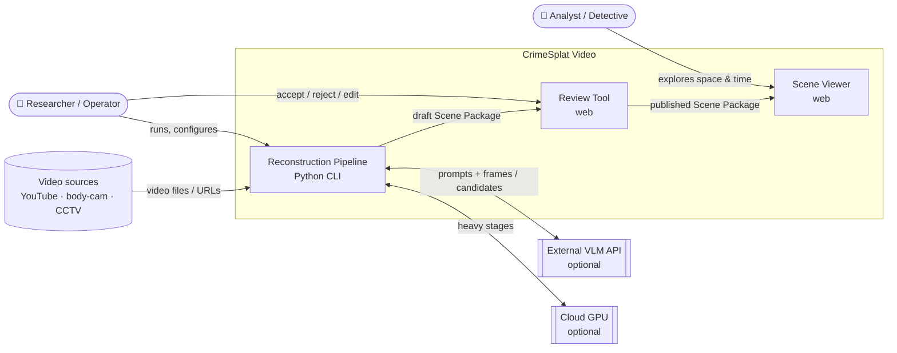
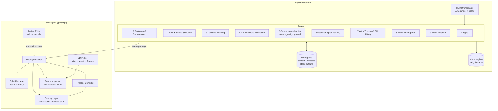
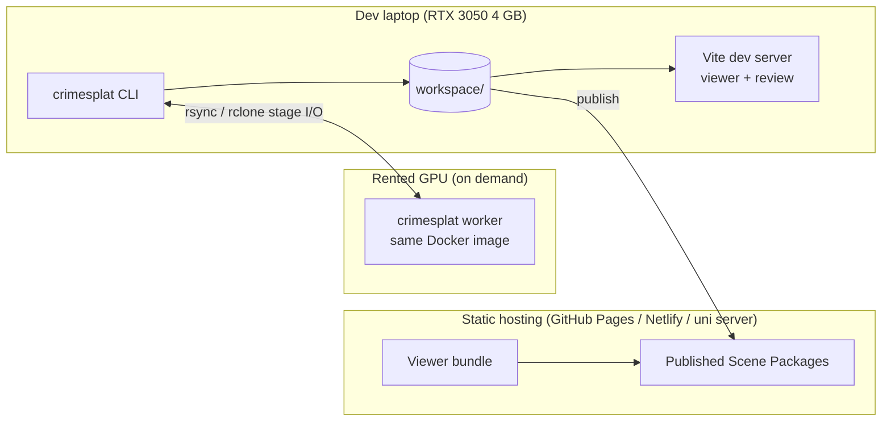

# 02 — High-Level Architecture

## 1. System context (C4 level 1)

The system has **three deployable units**:

| Unit | Type | Responsibility |
|---|---|---|
| **Pipeline** | Python package + CLI (`crimesplat`) | Video → draft Scene Package. Batch, GPU-heavy, resumable. |
| **Review Tool** | Web page (the same app as the Viewer, in "edit" mode) | A person verifies AI-proposed evidence and events, edits labels, adds manual annotations. |
| **Viewer** | Static web app (three.js + splat renderer) | Read-only exploration of a published Scene Package. Can be hosted on any static file host. |

There is **no always-on backend server** in v1. The Scene Package is a folder of files. The Viewer loads it statically, and the Review Tool writes edits back through a tiny local dev server (`crimesplat review <package>`). This keeps the system simple, reproducible, and easy to share for academic evaluation.

## 2. Container view (C4 level 2)

## 3. Pipeline stages at a glance

| # | Stage | Input | Output | Core tech | Laptop? |
|---|---|---|---|---|---|
| 1 | Ingest | URL / file(s) | Normalised video, `provenance.json`, audio track | yt-dlp, ffmpeg, SHA-256 | ✅ |
| 2 | Shot & frame selection | Video | Shot list, keyframes (sharp, well-spread), all-frame index | PySceneDetect, Laplacian variance, optical flow | ✅ |
| 3 | Dynamic masking | Keyframes + video | Per-frame masks (people, vehicles, overlays, redaction boxes) | YOLO11-seg / Grounded-SAM 2, SAM 2 video propagation | ✅ |
| 4 | Pose estimation | Keyframes + masks | Camera intrinsics + poses, sparse point cloud, poses for *all* frames | hloc (SuperPoint + LightGlue) → GLOMAP/COLMAP. Fallback: VGGT / MASt3R-SfM | ✅ / ☁️ fallback |
| 5 | Scene normalisation | Sparse model | Gravity-aligned, metric-scaled frame, ground plane | RANSAC plane fit, vanishing points, metric monocular depth | ✅ |
| 6 | Splat training | Undistorted keyframes + poses + masks + points | `scene.ply` (Gaussians) | gsplat (MCMC strategy), masked loss | ⚠️ capped / ☁️ full |
| 7 | Actor tracking & lifting | Video + poses + ground plane | `tracks.json` (3D actor positions over time). Optional SMPL | YOLO11 + BoT-SORT, ray-ground intersection, optional GVHMR | ✅ / ☁️ SMPL |
| 8 | Evidence proposal | Keyframes + poses + splat | Candidate evidence points with supporting frames | Grounding DINO / OWLv2, SAM 2, multi-view triangulation, VLM verify | ✅ + API |
| 9 | Event proposal | Video windows + audio + tracks | Candidate timestamped events | VLM over clip windows, Whisper, track heuristics | ✅ + API |
| 10 | Packaging | All above | Scene Package (compressed splat, JSON, thumbnails, manifest) | SPZ / SOG compression, JSON Schema validation | ✅ |

Stages 7–9 depend only on stage 4–5 outputs, **not** on stage 6. They can run in parallel with splat training, which matters because training is the longest stage.

## 4. Architectural principles

1. **Static geometry and dynamic content are separate.** The splat holds only what doesn't move. Everything that moves (actors, the camera) is a *time-indexed overlay* in the same coordinate frame. This is the central decision ([ADR-0001](decisions/0001-static-scene-plus-tracked-actors.md)).
2. **One world coordinate frame.** Every 3D quantity (Gaussians, cameras, actors, evidence) lives in the *scene frame* defined by stage 5: Y-up, metres, origin on the ground. Conversions happen only at stage boundaries.
3. **Everything links back to pixels.** Each derived claim stores `supporting_frames: [{frame_id, bbox|mask, confidence}]`. This is what makes the system explainable and the "click → see the frame" UX possible.
4. **Stages are pure functions over files.** `output = stage(inputs, config)`. Outputs are written to a content-addressed workspace keyed by `hash(inputs, config, code_version)`. This gives free caching, resumability and reproducibility.
5. **Models are plugins.** Each stage defines an interface (e.g., `PoseEstimator`, `Segmenter`, `Detector`, `VLMClient`), so models can be swapped for research ablations without touching the orchestration.
6. **AI proposes, people decide.** Automatic stages produce *candidates* with `status: "proposed"`. Only reviewed items (`status: "confirmed"`) are shown by default in the published Viewer.
7. **Degrade gracefully.** If SMPL lifting fails, actors fall back to capsules. If a VLM is unavailable, evidence detection falls back to detector-only. If scale estimation fails, the scene is shown unit-less with a warning.

## 5. Deployment view

- **Docker image** `crimesplat:cuda12` with all Python deps. The same image runs locally and on the cloud GPU.
- **Remote execution:** `crimesplat run --stage splat --remote runpod` syncs the stage inputs, runs the stage remotely, and syncs the outputs back. v1 can be manual (a script). Automating it is phase 3.
- **Publishing:** `crimesplat publish <package>` copies confirmed content to a static host. Real case data must **never** go to public hosting (see [09-evaluation-and-ethics.md](09-evaluation-and-ethics.md)).
