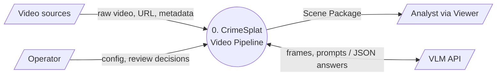
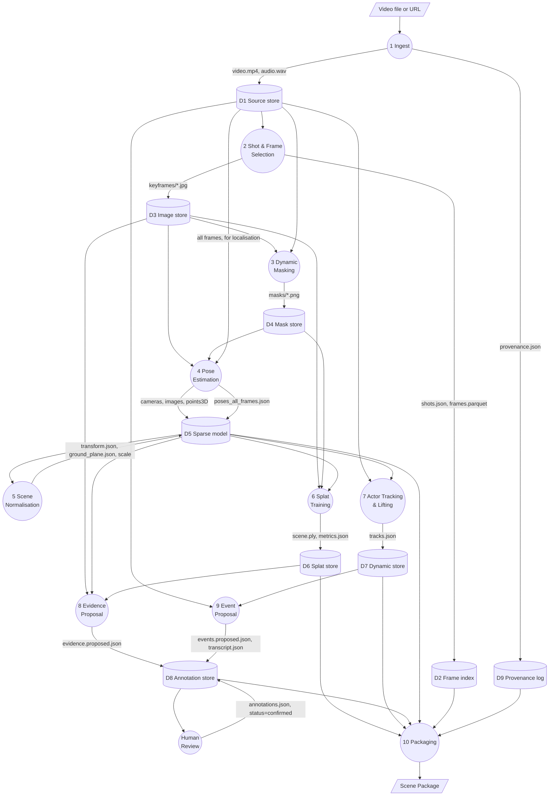
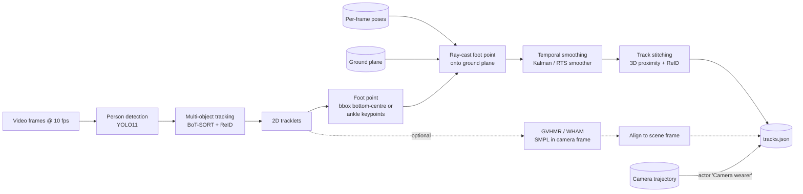
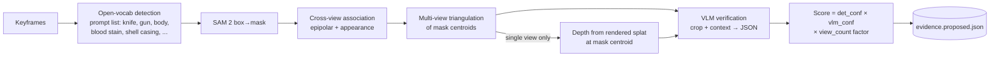
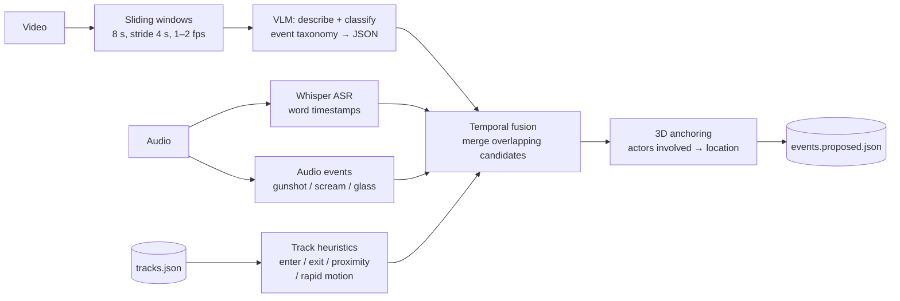
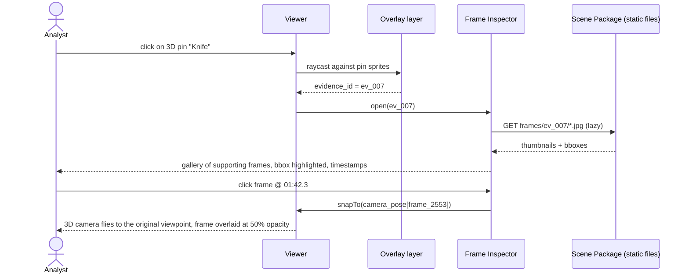
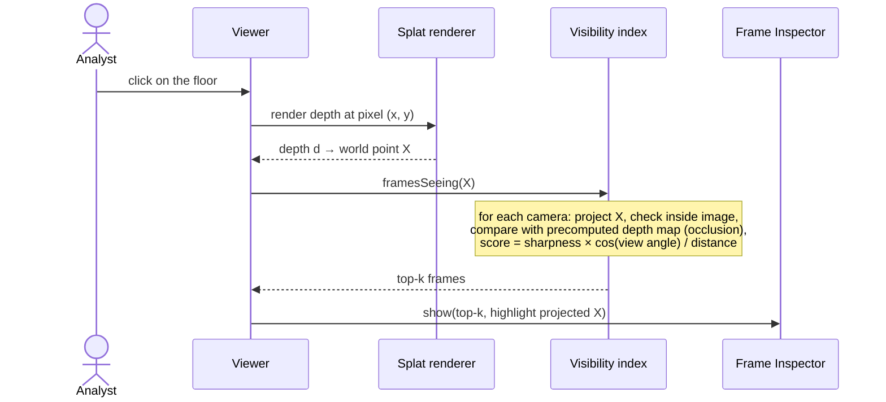
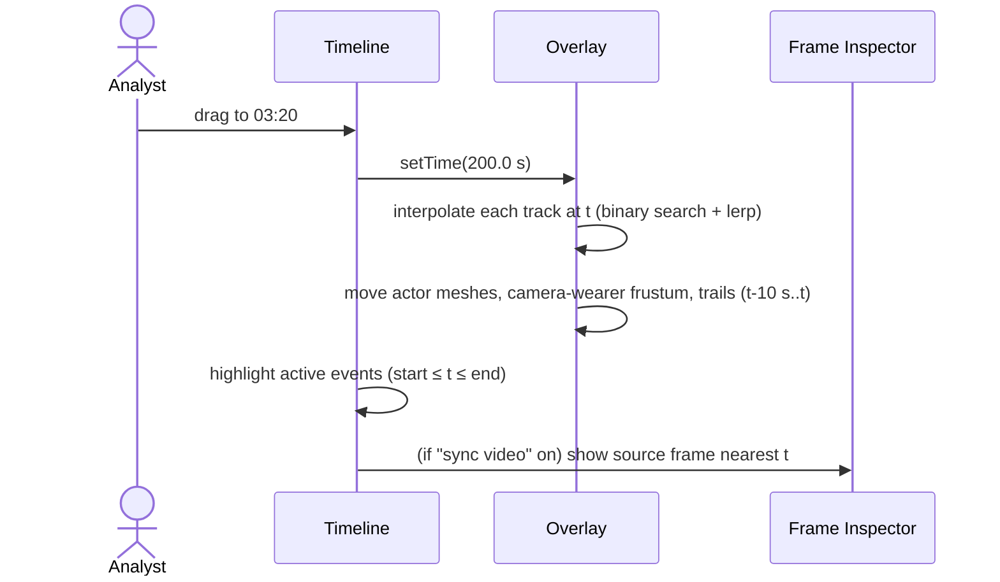
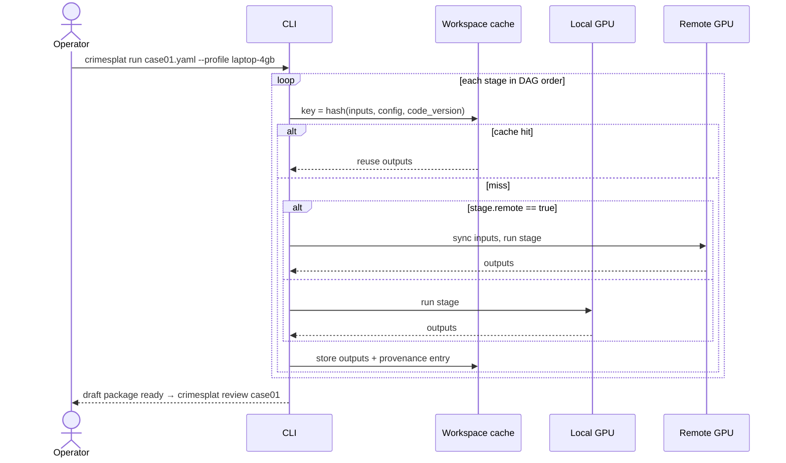

# 03 — Data Flow

Data-flow diagrams (DFDs) are given at three levels, followed by sequence diagrams for the key interactive flows.

## 1. DFD Level 0 — context

## 2. DFD Level 1 — pipeline stages

### 2.1 Data stores

| ID | Store | Format | Approx. size (2-min clip) |
|---|---|---|---|
| D1 | Source store | MP4 (original + normalised), WAV | 50–500 MB |
| D2 | Frame index | `frames.parquet` (one row per *video* frame: timestamp, shot, sharpness, is_keyframe, pose_id) | < 5 MB |
| D3 | Image store | JPEG keyframes (full + downscaled) | 100–400 MB |
| D4 | Mask store | 1-bit PNG per keyframe, per class | 10–50 MB |
| D5 | Sparse model | COLMAP binary + JSON exports | 5–50 MB |
| D6 | Splat store | PLY (uncompressed), SPZ (compressed) | 50–250 MB → 10–40 MB |
| D7 | Dynamic store | JSON / Parquet | < 10 MB |
| D8 | Annotation store | JSON (proposed + reviewed) | < 5 MB |
| D9 | Provenance log | JSON-lines, append-only | < 1 MB |

## 3. DFD Level 2 — key sub-flows

### 3.1 Stage 4: pose estimation (incl. all-frame localisation)

```mermaid
flowchart LR
    K[Keyframes + masks] --> F[Feature extraction<br/>SuperPoint, masked]
    F --> PS[Pair selection<br/>sequential window + retrieval NetVLAD]
    PS --> M[Matching<br/>LightGlue]
    M --> G[Global SfM<br/>GLOMAP]
    G -->|fails / < 60% registered| FB[Fallback<br/>VGGT / MASt3R-SfM ☁️]
    G --> BA[Bundle adjustment<br/>refine intrinsics incl. fisheye]
    FB --> BA
    BA --> SM[(Sparse model)]
    SM --> L[Localise all remaining frames<br/>PnP + RANSAC vs model]
    L -->|gaps| I[Interpolate<br/>SLERP + linear, flagged]
    L & I --> PA[(poses_all_frames.json)]
```

Why localise *all* frames? The timeline needs the camera (= body-cam wearer) pose at **any** time *t*, not just at the ~250 keyframes used for training. Actor lifting also needs a pose for every frame in which an actor is detected.

### 3.2 Stage 7: actor tracking and 3D lifting

### 3.3 Stage 8: evidence proposal

### 3.4 Stage 9: event proposal

## 4. Sequence diagrams (runtime)

### 4.1 Analyst clicks an evidence pin

### 4.2 Analyst clicks an arbitrary surface (FR-9)

### 4.3 Timeline scrub

### 4.4 Operator runs the pipeline

