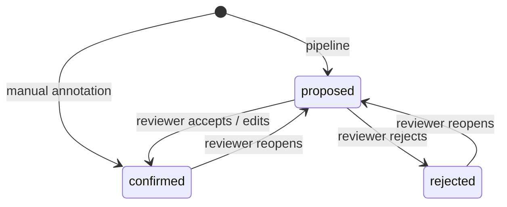
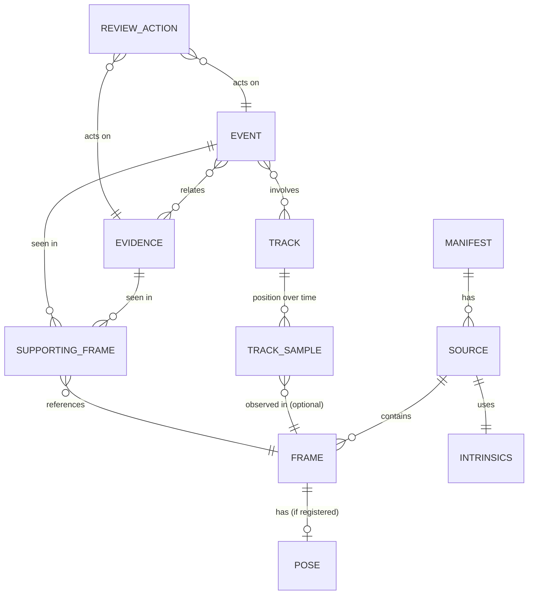

# 05 — Data Model & Scene Package Format

The **Scene Package** is the contract between the pipeline and the web app. It's a plain directory (or a `.zip` of one), so it can be served statically, archived and diffed.

## 1. Directory layout

```
case01.scene/
├── manifest.json                 # entry point; versions, file hashes, provenance
├── scene/
│   ├── scene.spz                 # compressed Gaussian splat (full)
│   ├── scene_preview.spz         # ≤150k Gaussians for first paint
│   └── transform.json            # scene frame ← raw SfM frame
├── cameras/
│   ├── intrinsics.json           # per source camera
│   ├── trajectory.json           # pose per indexed frame (all frames @ tracking fps)
│   └── visibility/               # per keyframe ¼-res depth for click lookup
│       └── f000123.png
├── dynamics/
│   ├── tracks.json               # actors over time
│   └── smpl/                     # optional per-track SMPL params (npz)
├── annotations/
│   ├── evidence.json             # evidence points (proposed + reviewed)
│   ├── events.json               # timeline events
│   └── transcript.json           # ASR, word-level timestamps
├── media/
│   ├── thumbs/f000123.jpg        # 480 px all keyframes
│   ├── frames/f000123.jpg        # 1080 p, only those referenced by evidence/events
│   └── video/source_0.mp4        # optional, for synced playback (may be omitted)
└── provenance/
    ├── provenance.jsonl          # append-only log of every stage run
    └── reports/                  # per-stage report.json
```

## 2. Conventions

- **Coordinate frame:** right-handed, **Y up**, units **metres** (or `"unitless"` if scale estimation failed), origin on the ground plane. Matches three.js.
- **Camera convention:** stored as `camera_to_world` 4×4 row-major, OpenCV axis convention (x right, y down, z forward). The viewer converts to OpenGL convention on load.
- **Time:** seconds as float from the start of `source_0` (the *master clock*). Multi-source cases store per-source `time_offset_s` in the manifest.
- **IDs:** `f{6-digit frame index}` per source (`s0:f000123`), `trk_###`, `ev_###`, `evt_###`.
- **Status lifecycle** for AI-produced items: `proposed → confirmed | rejected`. Manual items are created `confirmed` with `origin: "manual"`.



## 3. Entity-relationship model



## 4. Schemas (abridged, normative fields)

### 4.1 `manifest.json`

```json
{
  "schema_version": "1.0.0",
  "case_id": "case01",
  "created_at": "2026-11-07T14:02:11Z",
  "pipeline": { "version": "0.3.0", "git_commit": "abc1234", "profile": "laptop-4gb" },
  "units": "metres",
  "scale_uncertainty": 0.08,
  "sources": [
    {
      "id": "s0", "camera_id": "officer_1", "kind": "bodycam",
      "origin_uri": "https://www.youtube.com/watch?v=XXXX",
      "sha256": "9f2c…", "duration_s": 241.3, "fps": 30.0,
      "time_offset_s": 0.0
    }
  ],
  "sub_scenes": [{ "id": "main", "sources": ["s0"], "frames_registered_pct": 0.91 }],
  "files": { "scene/scene.spz": "sha256:…", "annotations/evidence.json": "sha256:…" },
  "quality": { "psnr": 24.1, "ssim": 0.81, "lpips": 0.21, "reproj_err_px": 0.92 }
}
```

### 4.2 `cameras/trajectory.json`

```json
{
  "fps": 10,
  "frames": [
    {
      "id": "s0:f000120", "t": 4.0, "keyframe": true,
      "c2w": [[...4], [...4], [...4], [0,0,0,1]],
      "pose_source": "sfm",          // sfm | localised | interpolated
      "sharpness": 0.82
    }
  ]
}
```

### 4.3 `dynamics/tracks.json`

```json
{
  "rate_hz": 10,
  "tracks": [
    {
      "id": "trk_000", "label": "Camera wearer", "kind": "wearer",
      "t_start": 0.0, "t_end": 241.3,
      "samples": [ { "t": 0.0, "p": [0.1, 0.0, 2.3], "heading": 1.57, "conf": 1.0, "src": "pose" } ]
    },
    {
      "id": "trk_003", "label": "Person 2", "kind": "person",
      "t_start": 10.2, "t_end": 215.0,
      "samples": [ { "t": 10.2, "p": [3.4, 0.0, -1.1], "conf": 0.74, "src": "lifted",
                     "frame": "s0:f000306", "bbox": [812, 220, 990, 700] } ],
      "smpl": "smpl/trk_003.npz",
      "status": "proposed"
    }
  ]
}
```

`src` values: `pose` (wearer), `lifted` (ray-ground), `depth` (unobserved feet), `predicted` (Kalman bridge across short occlusions; shown dashed in the viewer).

### 4.4 `annotations/evidence.json`

```json
{
  "items": [
    {
      "id": "ev_007",
      "label": "Knife",
      "category": "weapon",
      "description": "Kitchen knife on the floor next to the island, blade partially red.",
      "position": [2.31, 0.02, -0.84],
      "position_uncertainty_m": 0.12,
      "localisation": "triangulated",          // triangulated | depth | manual
      "confidence": 0.71,
      "origin": "auto",                         // auto | manual
      "status": "confirmed",
      "first_seen_t": 101.3,
      "supporting_frames": [
        { "frame": "s0:f003039", "t": 101.3, "bbox": [640, 512, 702, 560], "score": 0.88 }
      ],
      "provenance": { "detector": "grounding-dino-swin-t", "vlm": "claude-sonnet-5-5", "stage_key": "s08/4be1…" },
      "review": { "by": "reviewer_1", "at": "2026-11-07T15:10:00Z", "note": "label edited" }
    }
  ]
}
```

### 4.5 `annotations/events.json`

```json
{
  "taxonomy_version": "1.0",
  "items": [
    {
      "id": "evt_004",
      "type": "struggle",
      "title": "Struggle between Person 2 and camera wearer",
      "t_start": 199.5, "t_end": 207.0,
      "location": [1.2, 0.0, -2.0],
      "actors": ["trk_000", "trk_003"],
      "related_evidence": ["ev_007"],
      "confidence": 0.83,
      "signals": [
        { "source": "vlm", "conf": 0.7, "summary": "Two people grappling near doorway" },
        { "source": "tracks", "conf": 0.6, "rule": "actors_in_contact" },
        { "source": "audio", "conf": 0.5, "label": "scream" }
      ],
      "supporting_frames": [{ "frame": "s0:f005991", "t": 199.7 }],
      "status": "proposed"
    }
  ]
}
```

### 4.6 `provenance/provenance.jsonl` (one line per stage run)

```json
{"ts":"2026-11-07T14:00:02Z","stage":"s06_splat","stage_version":"1.2","cache_key":"7ac9…","inputs":{"s04":"31fd…","s03":"aa10…"},"config_hash":"c0de…","models":{"gsplat":"1.5.x"},"host":"laptop","gpu":"RTX 3050 Laptop 4GB","duration_s":3120,"status":"ok","outputs":{"scene.ply":"sha256:…"}}
```

## 5. Size budget (target for the default viewer)

| Item | Budget |
|---|---|
| `scene.spz` | ≤ 40 MB |
| `scene_preview.spz` | ≤ 5 MB |
| JSON total | ≤ 5 MB |
| Thumbnails | ≤ 30 MB |
| Visibility depths | ≤ 15 MB |
| **Total (without source video)** | **≤ 100 MB** |
