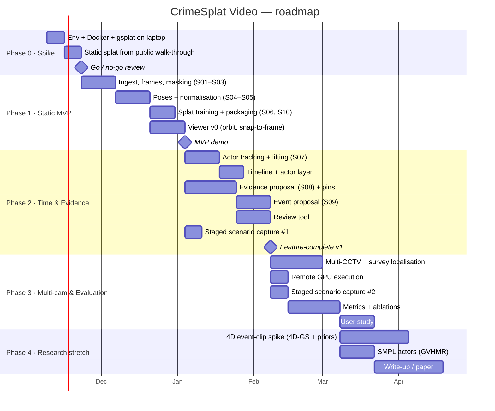

# 10 — Roadmap & Milestones

Durations assume one primary developer working part-time on an academic schedule. Adjust as needed.

## Phase 0 — Feasibility spike (≈ 2 weeks)
**Goal:** retire R-01 and R-02.
- [ ] Docker image with CUDA 12, gsplat, pycolmap / GLOMAP, hloc, SAM 2.
- [ ] Reconstruct a public, non-sensitive house-tour / walk-through video (1–2 min) end-to-end with scripts (no orchestrator yet).
- [ ] Measure VRAM and time on the laptop at caps of 200 k / 400 k. Measure the same on one cloud GPU run.
- [ ] View the result in Spark.
- **Exit:** the go / no-go criteria in [01-feasibility.md](01-feasibility.md) §5.

## Phase 1 — Static MVP (≈ 6 weeks)
- Orchestrator with caching, the CLI, stages S01–S06 and S10, schemas v1.
- Viewer v0: load package, orbit, camera path, snap-to-source-view, click-anywhere frame lookup.
- **Demo:** body-cam-style walk-through → explorable scene with clickable source frames.

## Phase 2 — Time & evidence (≈ 6–8 weeks)
- S07 actors + timeline. S08 / S09 proposals. Review tool.
- First staged scenario filmed and processed.
- **Demo:** the full one-shot user story on staged footage.

## Phase 3 — Multi-camera & evaluation (≈ 8 weeks)
- Multi-CCTV ingest, time sync, survey-video localisation.
- Remote execution for heavy stages.
- Metrics suite (`crimesplat eval`), ablations, user study.

## Phase 4 — Research stretch (≈ 6–8 weeks)
- 4D event-clip module ([research note](research/4dgs-feasibility.md)).
- SMPL actors.
- Paper / thesis write-up.

## Definition of done (v1)
- [ ] `crimesplat run` produces a valid Scene Package from a body-cam-style video with no manual steps except review.
- [ ] All FR-M requirements met; ≥ 50% of FR-S met.
- [ ] Metrics on ≥ 2 staged scenarios reported.
- [ ] Docs updated to match the implementation, with ADRs for any deviations.
