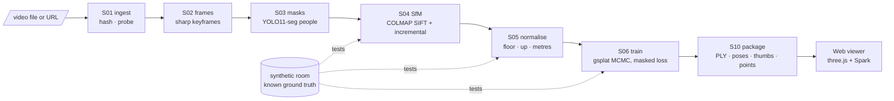

# 11 — Build Log & Technical Explainer

*How CrimeSplat v0.1 was built: every step, every command, every technology, and the theory behind each stage at a graduate level.*

| | |
|---|---|
| Covers | Sessions of 2026-11-07 → 2026-11-08 |
| Result | A working pipeline: **video → camera poses → metric, gravity-aligned scene → 3D Gaussian Splat → browser viewer** with click-to-source-frame lookup |
| Code | `pipeline/` (Python, ~1,300 lines), `web/` (TypeScript, ~550 lines), `scripts/`, `docs/` |

---

## Contents

1. [What exists now, in one picture](#1-what-exists-now-in-one-picture)
2. [Timeline: the eight phases of the build](#2-timeline-the-eight-phases-of-the-build)
3. [Every command, in order](#3-every-command-in-order)
4. [The technology stack and why each piece is there](#4-the-technology-stack-and-why-each-piece-is-there)
5. [Theory, stage by stage (graduate level)](#5-theory-stage-by-stage-graduate-level)
   - 5.1 [Video, frames and choosing keyframes](#51-video-frames-and-choosing-keyframes)
   - 5.2 [Instance segmentation and masks](#52-instance-segmentation-and-masks)
   - 5.3 [Camera geometry](#53-camera-geometry)
   - 5.4 [Structure-from-Motion](#54-structure-from-motion)
   - 5.5 [Similarity transforms, scale and gravity](#55-similarity-transforms-scale-and-gravity)
   - 5.6 [3D Gaussian Splatting: the representation and the renderer](#56-3d-gaussian-splatting-the-representation-and-the-renderer)
   - 5.7 [Training a splat](#57-training-a-splat)
   - 5.8 [Measuring quality](#58-measuring-quality)
   - 5.9 [The viewer's maths](#59-the-viewers-maths)
   - 5.10 [Engineering: caching, provenance, reproducible environments](#510-engineering-caching-provenance-reproducible-environments)
6. [How it was made to work: the debugging story](#6-how-it-was-made-to-work-the-debugging-story)
7. [Code walkthrough, file by file](#7-code-walkthrough-file-by-file)
8. [Reproducing everything from scratch](#8-reproducing-everything-from-scratch)
9. [Limitations and what comes next](#9-limitations-and-what-comes-next)
10. [Further reading](#10-further-reading)

---

## 1. What exists now, in one picture



Measured on the synthetic test room (RTX 3050 Laptop, 4 GB):

| Quantity | Value | What it means |
|---|---|---|
| Keyframes registered by SfM | 105 / 105 | Every chosen frame got a camera pose |
| Mean reprojection error | 0.70 px | 3D points land within ~1 px of where they were seen |
| Recovered focal length | 600.05 px (truth: 600) | Camera intrinsics self-calibrated from video alone |
| Trajectory error (ATE) | **4.3 mm mean**, 12 mm max | Estimated camera path vs. the true path |
| Metric scale error | **1.5 %** | From a single prior: "camera is 1.5 m above the floor" |
| Up-vector (gravity) error | **0.46°** | The floor really is flat in the viewer |
| Held-out PSNR | **28.6 dB** (min 25.7) | Renders of views never trained on |
| Training | 7,000 iterations, 464 s, 234,521 Gaussians, **0.52 GiB peak VRAM** | |

---

## 2. Timeline: the eight phases of the build

| # | Phase | What happened | Output |
|---|---|---|---|
| 1 | **Requirements** | Read `handoff.txt`. Asked 4 scoping questions: compute, 4D approach, footage types, context. Answers: RTX 3050, static + tracked actors, body-cam + multi-CCTV + YouTube, academic. | Scope |
| 2 | **Design docs** | Checked the GPU (`nvidia-smi` → 4 GB). Wrote 11 design documents and 5 decision records (ADRs). | `docs/00–10`, `docs/decisions/` |
| 3 | **4D research** | You sent 4D-GS (Wu et al.) and Dynamic 3D Gaussians (Luiten et al.). I extracted the PDFs' text, read the result tables and limitation sections, read both READMEs, and mapped each method onto our footage. | `docs/research/4dgs-feasibility.md` |
| 4 | **Re-plan for the GPU window** | You'd have a 40-series GPU for about 2 days. New goal: build and test everything on the laptop first. Four more questions: OS unknown, 1–3 weeks lead time, static splat end-to-end, you'll film the test video. | Plan |
| 5 | **Environment** | Found the one combination of versions with prebuilt CUDA wheels for both laptop and GPU machine. Resolved two install failures. Verified gsplat's CUDA kernels on the 3050. Introspected the pycolmap and gsplat APIs instead of guessing. | `pipeline/pyproject.toml`, `.venv` |
| 6 | **Pipeline** | Wrote config, workspace/caching, seven stages, and the CLI. Wrote a synthetic-room renderer with known camera poses, as a test fixture. | `pipeline/crimesplat/`, `tools/` |
| 7 | **Debugging to ground truth** | Five rounds of "measure against ground truth → find cause → fix". This took the trajectory error from 0.64 m to 4 mm (§6). Then training: 28.6 dB. | Verified pipeline |
| 8 | **Viewer + GPU prep** | Built the three.js/Spark viewer and tested it in the browser pane (you clicked around in it too). Added `crimesplat doctor`, `scripts/setup.sh`, a toy-size run of the 24 GB profile, the runbook, and doc updates. | `web/`, `scripts/`, `docs/gpu-day-runbook.md` |

---

## 3. Every command, in order

Long inline Python snippets are summarised, with their key lines shown. Every command ran from the repository root, `pipeline/` or `web/` as noted. ✅ = worked, ❌ = failed (and what that taught us).

### Phase 2 — hardware check
```bash
nvidia-smi --query-gpu=name,memory.total,driver_version --format=csv; nvcc --version; free -h; nproc
```
✅ `NVIDIA GeForce RTX 3050 Laptop GPU, 4096 MiB`, 15 GiB RAM, 16 threads. ❌ `nvcc` not found: no CUDA toolkit. This mattered later: we had to avoid anything that compiles CUDA code.

### Phase 3 — reading the 4D papers
| Command | Result |
|---|---|
| `WebFetch https://arxiv.org/pdf/2310.08528v2` | ❌ The fetcher returned raw compressed PDF bytes, but saved the binary locally |
| `WebFetch https://github.com/hustvl/4DGaussians` | ✅ README: Python 3.7, PyTorch 1.13 + CUDA 11.6, Apache-2.0, COLMAP-based custom data, ~8 min D-NeRF / ~30 min HyperNeRF training |
| `pdftotext -layout <saved.pdf> 4dgs.txt` | ✅ 817 lines of text |
| `grep -n -i -E "limitation\|rtx\|fps\|…" 4dgs.txt` | ❌ No output: grep saw the file as binary (stray bytes from the PDF) |
| `grep -a -n -i -E "…" 4dgs.txt` | ✅ `-a` forces text mode. Found Tables 1–3 and §5.5 Limitations |
| `sed -n '311,380p;465,480p;755,800p' 4dgs.txt` | ✅ Read the result tables and limitations verbatim |
| `curl -sL -o d3dgs.pdf https://arxiv.org/pdf/2308.09713 && pdftotext …` + `grep -a` | ✅ Dynamic 3D Gaussians: 27 training cameras, 150 timesteps, ~2 h on an RTX 3090, 28.7 PSNR, 850 FPS |
| `WebFetch https://github.com/JonathonLuiten/Dynamic3DGaussians` | ✅ MIT + Inria non-commercial rasteriser. Custom-data prep never released |

### Phase 5 — environment
```bash
# What's installed?
for c in python3 python3.11 python3.12 uv conda pip docker colmap glomap ffmpeg ffprobe yt-dlp git-lfs node pnpm npm; do …; done
```
✅ Present: Python 3.14 (too new for PyTorch wheels), **uv 0.13.6**, **ffmpeg 9.0.2**, Node 26, npm. Missing: torch, COLMAP, conda, Docker.

```bash
nvidia-smi | grep "CUDA Version"                        # driver supports CUDA 13.4 → can run CUDA 12.x wheels
curl -sL https://docs.gsplat.studio/whl/gsplat/ | …      # list of prebuilt gsplat wheels
curl -sL https://pypi.org/pypi/gsplat/json | …          # gsplat 1.5.3: PyPI has only source + pure-python wheel
curl -sL https://pypi.org/pypi/pycolmap/json | …        # pycolmap 4.2.1: manylinux wheels for cp310–cp314
```
**Key finding:** gsplat's *prebuilt CUDA* wheels exist only for **Python 3.10**. The newest combination is **torch 2.4 + CUDA 12.4**, for both Linux and Windows. Without a prebuilt wheel, gsplat JIT-compiles its CUDA kernels on first use, which needs `nvcc` (absent here, and maybe absent on the GPU machine). So the whole environment was pinned around `gsplat 1.5.3+pt24cu124`.

```bash
cd pipeline && uv sync
```
❌ `No solution found … torchvision==0.19.1+cu124 has no Linux-compatible wheels … platform_machine == 'aarch64'`.
*Why:* uv builds a **universal lockfile** that must resolve for every platform. PyTorch has no CUDA wheels for ARM Linux. *Fix:* restrict `tool.uv.environments` to `linux x86_64` and `win32`.

```bash
uv sync && uv run python -c "import torch, gsplat, pycolmap, cv2, ultralytics; …"
```
✅ `2.4.1+cu124 True NVIDIA GeForce RTX 3050 Laptop GPU · gsplat 1.5.3+pt24cu124 · pycolmap 4.2.1 · cv2 5.0.0`

```bash
uv run python -c "from gsplat import rasterization; … render 1000 random Gaussians …"
```
❌ `ModuleNotFoundError: No module named 'setuptools'`. *Why:* gsplat imports `torch.utils.cpp_extension`, which imports `setuptools` at import time, and Python 3.10 venvs made by uv don't include it. *Fix:* add `setuptools<75` as a dependency (a conservative pin for torch 2.4's extension loader).
✅ After the fix: `render ok torch.Size([1, 240, 320, 4]) True`. The CUDA kernels run on the 3050.

```bash
# API introspection (instead of guessing signatures)
uv run python -c "import pycolmap; print(pycolmap.extract_features.__doc__) …"
```
❌ `inspect.signature()` fails on pybind11 builtins. ✅ Using `__doc__` instead showed the exact signatures. Two notable discoveries:
- `pycolmap.global_mapping(...)`: **GLOMAP is built into pycolmap 4.2**, so no separate build is needed.
- `pycolmap.has_cuda == False`: the wheel is CPU-only, so SIFT and bundle adjustment run on the CPU. That's fine for ~300 frames, and it behaves identically on both machines.

Further introspection: option-struct fields (`ImageReaderOptions.mask_path`, `SequentialPairingOptions.overlap`, …), `Image.cam_from_world()` (a method in 4.x, not a property), `Sim3d(scale, Rotation3d, t)`, and `Camera.img_from_cam()` (vectorised, used for undistortion). Then gsplat's `MCMCStrategy` source (`sed -n 40,150p mcmc.py`) for `cap_max`, `refine_*` and `step_post_backward(…, lr)`.

### Phase 6–7 — pipeline and debugging
```bash
uv run python tools/make_synthetic_video.py ../data/synthetic_room.mp4     # 300 frames, 960×540, ~80 s to render
ffmpeg -ss 5 -i ../data/synthetic_room.mp4 -frames:v 1 synth_frame.jpg     # look at one frame
uv run crimesplat init synth --source ../data/synthetic_room.mp4 --footage handheld --profile laptop-4gb
uv run crimesplat run synth --until normalize
```
The full debugging sequence is narrated in §6. The commands it used:
```bash
uv run crimesplat run synth --until normalize --force sfm      # re-run SfM after a fix (x4)
uv run crimesplat run synth --until normalize --force ingest   # after re-rendering the test video (x2)
uv run python gt_check.py ../workspace/synth ../data/synthetic_room.gt.json   # now tools/eval_poses.py
uv run python - <<EOF … cv2 seek test … EOF                  # is OpenCV frame seeking exact? (yes)
uv run python - <<EOF … relative-rotation test, global vs incremental … EOF
uv run python - <<EOF … ATE on sfm/ vs normalize/, per-frame errors … EOF
```
Then training, packaging and status:
```bash
uv run crimesplat run synth --until train      # 7.7 min, 28.63 dB
uv run crimesplat run synth                    # package: 105 frames, 16,834 points, 48.6 MB
uv run crimesplat status synth
```

### Phase 8 — viewer and GPU prep
```bash
npm view @sparkjsdev/spark version peerDependencies     # 2.4.0, needs three >= 0.180
npm view three version; npm view vite version           # 0.187.0, 8.3.6
cd web && npm install                                   # 25 packages
grep … node_modules/@sparkjsdev/spark/dist/types/*.d.ts # SplatMesh options: raycastable, initialized promise
npx tsc --noEmit                                        # type-check: clean
uv run crimesplat publish-local synth                   # copy package into web/public/scenes/synth
```
- The browser pane started the Vite dev server from `.claude/launch.json` and opened `http://localhost:5173/?scene=scenes/synth`. I took screenshots and fixed two UI bugs (§6).
- `read_console_messages` showed no errors.

```bash
uv run crimesplat doctor          # ✓ GPU, ✓ CUDA kernels, ✓ COLMAP, ✓ ffmpeg → suggested profile laptop-4gb
uv run crimesplat run synth_gpu_profile     # gpu-24gb profile at toy size: unpacked raster, SH 3, YOLO11x all OK
uv run python tools/eval_poses.py ../workspace/synth ../data/synthetic_room.gt.json
```

---

## 4. The technology stack and why each piece is there

| Layer | Technology | Version | Role | Why this one |
|---|---|---|---|---|
| Package / env manager | **uv** | 0.13.6 | Creates the Python 3.10 venv, resolves and locks deps | Fast, downloads Python itself, cross-platform lockfile |
| Language | Python | 3.10.22 | Pipeline | Forced by gsplat's prebuilt CUDA wheels |
| Tensor / autodiff | **PyTorch** | 2.4.1 + cu124 | GPU tensors, Adam, autograd | Required by gsplat; CUDA 12.4 runs on both GPUs |
| Splatting | **gsplat** | 1.5.3 | Differentiable CUDA rasteriser + MCMC densification | Memory-efficient, Apache-2.0, prebuilt wheels (ADR-0002) |
| SfM | **pycolmap** (COLMAP 4 + GLOMAP + Ceres) | 4.2.1 | SIFT, matching, mapping, bundle adjustment | Gold-standard SfM, pip-installable, no build |
| Image ops | OpenCV (headless) | 5.0.0 | Decoding, Laplacian, remap/undistortion, I/O | Standard |
| Segmentation | **Ultralytics YOLO11-seg** | 8.4.205 | People/vehicle masks | Fast; one call gives instance masks. AGPL is fine for academic use. |
| Shot detection | PySceneDetect | ≥ 0.6.4 | Detects edits/cuts | Simple and reliable |
| Download | yt-dlp | 2026.10.21 | YouTube/URL ingest | De-facto standard |
| Probe | ffmpeg / ffprobe | 9.0.2 | Codec, fps, duration, rotation | Ground truth for video metadata |
| Splat file I/O | plyfile | ≥ 1.0 | Writes the standard 3DGS `.ply` | Universally readable by viewers |
| Config | pydantic v2 + PyYAML | | Typed, validated configuration | Errors at load time, not mid-run |
| CLI / output | Typer + Rich | | `crimesplat` command, tables | |
| Front-end build | Vite + TypeScript | 8.3.6 / 5.9.3 | Dev server, bundling, type safety | |
| 3D engine | **three.js** | 0.187.0 | Scene graph, camera, raycasting, lines | Ubiquitous |
| Splat renderer | **Spark** (`@sparkjsdev/spark`) | 2.4.0 | Renders splats *inside* a three.js scene, raycastable | Splats and normal meshes share depth (ADR in doc 06) |
| Docs | Markdown + Mermaid | | Diagrams as code | Renders on GitHub |

---

## 5. Theory, stage by stage (graduate level)

### 5.1 Video, frames and choosing keyframes

**Video basics.** A video is a sequence of frames at a frame rate (here 15 fps for the synthetic clip; phones film at 30 or 60). Codecs (H.264/HEVC) store few full *keyframes* (I-frames) and many *predicted* frames. Two practical consequences:
- **Seeking** to frame *n* may decode from the previous I-frame. Some decoders land on the wrong frame. We tested OpenCV's seeking against sequential decoding on our file and it was exact (§6), but the frame index is kept as the canonical ID anyway.
- **Variable frame rate (VFR):** phones vary the frame interval. `ffprobe` compares `avg_frame_rate` with `r_frame_rate` to flag it. Timestamps then come from frame index / fps, an approximation that's fine for v0.

**Why not use every frame?** Consecutive frames are nearly identical. That multiplies SfM cost (matching is O(N²) pairs when exhaustive) and adds little geometry. Typical splat datasets use 100–400 well-spread images.

**Sharpness score: variance of the Laplacian.** The Laplacian ∇²I = ∂²I/∂x² + ∂²I/∂y² is approximated by convolving with

$$\begin{bmatrix}0&1&0\\1&-4&1\\0&1&0\end{bmatrix}$$

It responds to high spatial frequencies (edges and texture). Motion blur is a low-pass filter, so a blurry frame has a low-variance Laplacian response. We compute it on a 640 px-wide grey copy so scores are comparable across resolutions.

**Selection algorithm** (`stages/frames.py`):
1. Decode candidates at `candidate_fps` (≈6–7.5 fps).
2. Split the timeline into `target_keyframes` equal bins and keep the sharpest candidate per bin. This gives even temporal coverage, which for a walking camera approximates even *spatial* coverage.
3. Drop a bin's winner if it's below the clip-wide 30th sharpness percentile, i.e., the whole bin was blurry.

On the test clip: 150 candidates → 105 keyframes. When bins hold one candidate each, the percentile rule removes ~30%. On a 2-minute real clip, bins hold several candidates and almost none are dropped.

### 5.2 Instance segmentation and masks

Static 3D reconstruction assumes the world doesn't move. People do. A pedestrian seen in 40 frames gets "explained" by the optimiser as a semi-transparent smear, a **ghost** or **floater**. We remove them in two places:
1. **SfM:** features on people would produce matches that violate the static-world epipolar geometry. COLMAP accepts a per-image mask (`mask_path/<image>.png`, black = ignore) and doesn't extract features there.
2. **Training:** masked pixels are excluded from the loss (§5.7), so no Gaussian is pushed to explain them.

**YOLO11-seg** is a single-stage detector with a mask head. It predicts boxes plus a set of *prototype masks*, and each instance's mask is a linear combination of prototypes (the YOLACT idea), cropped to its box. We keep COCO classes for people, vehicles and animals. We union the instances, then **dilate** by 1.5% of image width, because masks are tight and motion blur and shadows spill outside them. Frames with more than 70% masked are excluded from SfM: too little static content to match.

Two mask conventions are written because the consumers disagree: `masks/` (255 = dynamic, for our loss) and `colmap_masks/<name>.jpg.png` (0 = ignore, COLMAP's convention and naming).

### 5.3 Camera geometry

**Pinhole model.** A world point **X** maps to pixel **u** by

$$\lambda \begin{bmatrix}u\\v\\1\end{bmatrix} = K\,[R\,|\,t]\begin{bmatrix}\mathbf X\\1\end{bmatrix},\qquad K=\begin{bmatrix}f_x&0&c_x\\0&f_y&c_y\\0&0&1\end{bmatrix}$$

**R**, **t** (the *extrinsics*, `cam_from_world`) move the point into the camera frame. **K** (the *intrinsics*) maps normalised coordinates (x/z, y/z) to pixels. The camera centre in world coordinates is **C** = −Rᵀt.

**Lens distortion models (COLMAP names):**
- `SIMPLE_RADIAL`: one focal f, principal point, one radial term: x_d = x(1 + k r²), r² = x² + y². Few parameters, so well constrained from video. **Our default for phones.**
- `OPENCV`: f_x, f_y, k₁, k₂, p₁, p₂ (radial + tangential). More flexible, but with no EXIF prior, f_x and f_y drifted apart in testing (608 vs 582).
- `OPENCV_FISHEYE` (Kannala–Brandt): distortion in the *angle* θ = atan(r): θ_d = θ(1 + k₁θ² + k₂θ⁴ + k₃θ⁶ + k₄θ⁸). Needed for 120–170° body-cams.

**Undistortion by remapping** (`dataset.py`). gsplat renders an ideal pinhole camera, so training images must be undistorted. For every *output* pixel (u, v) of a new pinhole camera K′:
1. form the ray K′⁻¹[u, v, 1]ᵀ;
2. ask COLMAP where that ray lands in the *distorted* image (`cam.img_from_cam`);
3. sample there (`cv2.remap`).

Images use bilinear (or area) interpolation. Masks use nearest-neighbour, so they stay binary. Output pixels whose source falls outside the frame (fisheye corners) are added to the mask. Because the same map is used for images and masks, they stay aligned for any lens model. Pixel centres follow COLMAP's convention: the centre of the top-left pixel is (0.5, 0.5), hence the ±0.5 terms.

**Two axis conventions.** OpenCV/COLMAP cameras use x right, **y down, z forward**. OpenGL/three.js cameras use x right, **y up, looking down −z**. Converting a camera-to-world matrix means negating its y and z columns, i.e., right-multiplying by diag(1, −1, −1) (`frameMatrix()` in `web/src/scene.ts`). Getting this wrong mirrors or flips every overlay.

### 5.4 Structure-from-Motion

SfM recovers all camera poses **and** a sparse 3D point cloud from images alone.

**1. Features: SIFT.** Build a Gaussian scale-space, find extrema of the Difference-of-Gaussians across scale and space, then assign each keypoint a dominant orientation. Describe it with a 128-D histogram of local gradient orientations (4×4 cells × 8 bins). This is invariant to scale, rotation and (largely) illumination. We extract up to 8,192 per image, at up to 1,600 px.

**2. Matching.** Pairs are chosen exhaustively (< 120 images) or sequentially (each image with its next ~15, plus quadratic offsets for longer-range pairs). Descriptors are matched by nearest neighbour with **Lowe's ratio test** (best distance < 0.8 × second best), which rejects ambiguous matches.

**3. Geometric verification.** True matches between two views of a static scene satisfy the **epipolar constraint** x₂ᵀ F x₁ = 0, where F is the fundamental matrix (or E = K₂ᵀFK₁, the essential matrix, when calibrated). F, E and a homography H are estimated with **RANSAC**:
- repeatedly fit a model to a minimal random sample (7/8 points for F, 5 for E);
- count inliers;
- keep the best model.

Pairs that are better explained by H than F have rotation-only or planar geometry, so they're flagged for initialisation. Only inlier matches survive.

**4a. Incremental mapping (our default).**
1. **Initialise** from the pair with many inliers *and* enough triangulation angle. Decompose E into (R, t), giving four candidates; pick the one with points in front of both cameras (cheirality). Triangulate.
2. **Register** the next image that sees the most existing 3D points by solving **Perspective-n-Point** (P3P inside RANSAC) from 2D–3D correspondences.
3. **Triangulate** new points seen by the new image.
4. **Bundle adjustment (BA):** jointly refine every pose, intrinsic and point by minimising robust reprojection error

$$\min_{\{R_i,t_i,K\},\{X_j\}}\ \sum_{(i,j)} \rho\!\left(\big\lVert \pi(K, R_i, t_i, X_j) - x_{ij} \big\rVert^2\right)$$

with Levenberg–Marquardt in Ceres. Here ρ is a robust (e.g., Cauchy) loss and π is projection with distortion. Local BA runs after each registration; global BA runs periodically.

5. Repeat until no image can be added.

Incremental SfM is slower (it's sequential) but very robust, because every step is verified against a growing, already-optimised model.

**4b. Global mapping (GLOMAP).**
1. Estimate all *relative* rotations from the verified pairs, then solve **rotation averaging**: find absolute rotations R_i that best agree with all R_ij ≈ R_j R_iᵀ at once.
2. **Global positioning:** solve camera positions *and* 3D points jointly from bearing rays. This is GLOMAP's key contribution over classic translation averaging.
3. Global BA.

GLOMAP is much faster on large unordered photo sets, but the relative poses in step 1 come from the *essential* matrix, which needs the focal length. Video has no EXIF, so COLMAP falls back to a prior of 1.2 × max(width, height) = 1,152 px, while the true value was 600 px. With a prior that wrong, the rotation graph starts badly. That's consistent with what we measured: GLOMAP 4.7° up error and a 29 cm outlier, vs. incremental's 0.5° and 12 mm max (§6). It printed exactly this warning: *"global mapper depends on reasonably good focal length priors."*

**Outlier cameras.** Rarely, a camera is registered far from everyone else. In one GLOMAP run a single camera sat 43,512 units away. It's removed by a robust distance test: more than 6× the median distance from the median camera centre → deregister.

### 5.5 Similarity transforms, scale and gravity

**The gauge freedom.** From images alone, a reconstruction is defined only up to a **similarity transform** Sim(3): 3 rotation, 3 translation and 1 scale degrees of freedom. Multiplying all points and camera centres by 2 produces identical images. So SfM output has arbitrary orientation, origin and **units**. Stage S05 fixes all seven:

$$\mathbf X_{\text{scene}} = s\,R\,\mathbf X_{\text{sfm}} + \mathbf t$$

**Up (gravity), rotation R.**
1. *First guess:* people hold cameras roughly upright, so the average camera "up" (the negative image-y axis in world coordinates, −R_iᵀ e_y) approximates gravity.
2. *Refinement:* find the floor plane with **RANSAC over near-horizontal planes**:
   - sample 3 points below the cameras;
   - normal n = (b − a) × (c − a);
   - reject if tilted more than 12° from the first-guess up (this discards walls);
   - count inliers |n · (p − a)| < τ.

   Among the surviving horizontal planes (floor, table tops, box tops), take the **lowest one with at least 30% of the best plane's support**. Refine its normal by SVD of the inliers: the normal is the right-singular vector with the smallest singular value, i.e., the direction of least variance.
3. R is built as an orthonormal basis: y = floor normal, x = mean camera-right made orthogonal to y (Gram–Schmidt), z = x × y (right-handed).

**Scale s.** One prior: the camera's height above the floor. Phone at chest or eye ≈ 1.5 m, body-cam ≈ 1.45 m. Then s = h_prior / median(camera height above floor in SfM units). This exploits the fact that people walk at a near-constant camera height, and it gave 1.5% scale error on the test room. Drone and news footage has no such prior, so those scenes stay `unitless`.

**Translation t** puts the origin on the floor directly beneath the first camera.

**Evaluating poses: Umeyama alignment and ATE.** To compare estimated centres Ĉ_i with ground truth C_i, solve for the similarity (s, R, t) minimising Σ‖C_i − (sRĈ_i + t)‖² in closed form (Umeyama 1991):
- centre both point sets;
- take the SVD of their cross-covariance, Σ = UDVᵀ;
- R = U S Vᵀ, with S correcting reflections;
- s = tr(DS) / σ²_Ĉ;
- t from the centroids.

The remaining per-camera residual is the **Absolute Trajectory Error (ATE)**. ATE is invariant to S05 (which is itself a similarity), which is how we proved in §6 that the error came from SfM and not from normalisation. The fitted s tells us the scale error: s = 0.985 means our metres are 1.5% too long. `tools/eval_poses.py` implements all of this.

### 5.6 3D Gaussian Splatting: the representation and the renderer

**Representation.** The scene is a set of N anisotropic 3D Gaussians. Each one has:

| Parameter | Stored as | Meaning |
|---|---|---|
| mean μ ∈ ℝ³ | `means` | position |
| rotation q ∈ ℝ⁴ | `quats` (normalised on use) | orientation |
| scale s ∈ ℝ³ | `scales` = log σ (exp on use, keeps σ > 0) | ellipsoid radii |
| opacity o | `opacities` = logit (sigmoid on use, keeps 0 < o < 1) | peak opacity |
| colour | `sh0` (1×3) + `shN` ((L+1)²−1 × 3) | spherical-harmonic coefficients |

Its covariance is factored so it's always positive semi-definite during optimisation:

$$\Sigma = R\,S\,S^\top R^\top,\qquad S = \operatorname{diag}(e^{s_1},e^{s_2},e^{s_3}),\quad R = R(q)$$

**View-dependent colour.** Colour is a function of viewing direction **d**, expanded in real spherical harmonics up to degree L:

$$c(\mathbf d) = \sum_{\ell=0}^{L}\sum_{m=-\ell}^{\ell} c_{\ell m}\,Y_{\ell m}(\mathbf d)$$

At degree 0 this is a constant: c = C₀·c₀₀ + 0.5 with C₀ = 0.28209… That's why initial colours are stored as (rgb − 0.5)/C₀ (`_init_params`). Degree 2 (laptop) has 9 coefficients per channel. Degree 3 (GPU profile) has 16, enough for gentle specular effects.

**Projection to 2D (EWA splatting).** A 3D Gaussian under the perspective map isn't exactly Gaussian, so it's linearised at the mean:

$$\Sigma' = J\,W\,\Sigma\,W^\top J^\top$$

Here W is the world-to-camera rotation and J the Jacobian of the projection at μ_cam. We take the top-left 2×2 block, and gsplat adds 0.3 px² (`eps2d`) to the diagonal as a low-pass filter, so tiny Gaussians cover at least about a pixel.

**Rasterisation (tile-based).**
1. Cull Gaussians outside the frustum and compute each one's 2D footprint (≈3σ).
2. Split the image into 16×16-pixel tiles. Duplicate each Gaussian into every tile it overlaps, with a 64-bit key (tile ID | depth). **Radix-sort** all keys on the GPU, which sorts by tile and then front-to-back within each tile.
3. One CUDA block per tile walks its list front-to-back and **alpha-composites**:

$$C(\mathbf p) = \sum_{i} c_i\,\alpha_i \prod_{j<i}(1-\alpha_j),\qquad \alpha_i = o_i \exp\!\left(-\tfrac12(\mathbf p-\mu'_i)^\top \Sigma_i'^{-1}(\mathbf p-\mu'_i)\right)$$

It stops early once the accumulated transmittance Π(1−α_j) falls below ~10⁻⁴.

This is identical in form to NeRF's volume rendering quadrature, but with explicit primitives instead of ray-marched samples of an MLP. That's why it renders at hundreds of FPS.

**Differentiability.** Every step (projection, Σ′, α, compositing) is differentiable, so ∂loss/∂(μ, q, s, o, SH) can be computed. gsplat's backward kernel re-traverses each tile back-to-front, reconstructing the transmittance terms without storing them all. `packed=True` stores only the visible (camera, Gaussian) pairs instead of dense C×N tensors, which is what keeps memory low on 4 GB.

### 5.7 Training a splat

**Initialisation.**
- One Gaussian per SfM point: 16,834 here.
- Colour from the point's colour.
- Isotropic scale = the mean distance to its 3 nearest neighbours (computed on the GPU with chunked `torch.cdist`).
- Opacity 0.5.
- A random rotation.

**Loss** (per iteration, one random training view):

$$\mathcal L = (1-\lambda)\,\mathcal L_1 + \lambda\,(1-\mathrm{SSIM}) + \lambda_o\,\overline{\sigma(o)} + \lambda_s\,\overline{e^{s}},\qquad \lambda=0.2,\ \lambda_o=\lambda_s=0.01$$

- L₁ is the mean absolute colour error over **unmasked pixels only**: the per-pixel error is multiplied by the validity mask and divided by the number of valid pixels.
- **SSIM** (structural similarity) compares local means, variances and covariance in an 11×11 Gaussian window (σ = 1.5):

$$\mathrm{SSIM}(x,y)=\frac{(2\mu_x\mu_y+C_1)(2\sigma_{xy}+C_2)}{(\mu_x^2+\mu_y^2+C_1)(\sigma_x^2+\sigma_y^2+C_2)},\quad C_1=0.01^2,\ C_2=0.03^2$$

  We compute the per-pixel SSIM *map* (`_ssim_map`) and average it over valid pixels, so the masking applies to SSIM too.
- The two small regularisers (from the MCMC paper) push unused Gaussians towards low opacity and small size, so they get recycled (below).

**Optimiser.** Adam, one parameter group per attribute:
- means: lr = 1.6×10⁻⁴ × scene extent, decayed exponentially to 1% by the end;
- scales: 5×10⁻³;
- rotations: 10⁻³;
- opacity: 5×10⁻²;
- SH₀: 2.5×10⁻³, higher-order SH: 1/20 of that.

The SH degree increases by one every 1,000 steps (coarse colour first, view-dependence later), which stabilises early training.

**Where do new Gaussians come from? MCMC densification.** The original 3DGS used heuristics: clone or split Gaussians with large positional gradients, and prune transparent ones. The count is hard to predict, which is dangerous on 4 GB. **3DGS-as-MCMC** (Kheradmand et al., 2024) reinterprets the Gaussians as samples from a distribution proportional to how well they explain the images, with training as Stochastic-Gradient Langevin Dynamics. gsplat's `MCMCStrategy` does, every 100 steps between steps 500 and `refine_stop_iter`:
- **relocate:** Gaussians with opacity below 0.005 ("dead") are teleported onto live Gaussians, chosen with probability ∝ opacity. Opacity and scale are adjusted with a binomial-coefficient formula so the rendered image is approximately unchanged (the `binoms` table in its state).
- **add:** grow the population by 5%, up to `cap_max`.

And after *every* step:
- **noise:** add Gaussian noise to positions, scaled by `lr × noise_lr` and larger for low-opacity Gaussians. This is the "Langevin" exploration that lets Gaussians find under-reconstructed regions.

You can see this in the training log. `refine_stop_iter` = 0.85 × 7000 = 5,950, so growth ran for (5,950 − 500)/100 ≈ 54 refinements, and 16,834 × 1.05⁵⁴ ≈ 233,000. That matches the **234,521** we got. The 300k cap was never reached, and the count stayed constant from step 6,000 onwards.

**Memory discipline.** Training images live in pinned CPU memory and are copied to the GPU one per step (`non_blocking=True`). Only the Gaussians and Adam state live on the GPU. Result: 0.52 GiB peak at 960×540 with 234k Gaussians.

**Output.** The standard 3DGS PLY layout, readable by every splat viewer:

`x y z · nx ny nz (zeros) · f_dc_0..2 · f_rest_0..(3·((L+1)²−1)−1) · opacity (logit) · scale_0..2 (log) · rot_0..3 (wxyz)`

`f_rest` is stored channel-major (all R coefficients, then G, then B), hence the `transpose(0, 2, 1)` in `save_ply`.

### 5.8 Measuring quality

- **Held-out views:** every 8th keyframe (13 of 105) is never trained on. We render the splat from those cameras and compare. That measures generalisation to new viewpoints, not memorisation.
- **PSNR** (peak signal-to-noise ratio), for images in [0, 1]:

  $$\mathrm{PSNR} = 10\log_{10}\frac{1}{\mathrm{MSE}}$$

  computed over unmasked pixels. Each +3 dB halves the squared error. Rough guide: < 20 dB is visibly wrong, 25–30 dB is good, > 30 dB is excellent.
- **Reprojection error, registered fraction, track length** for SfM. **ATE / scale / up error** against ground truth (§5.5).
- Side-by-side renders (`train/eval_renders/`: ground truth left, render right) for eyeballing.

### 5.9 The viewer's maths

**Rendering.** Spark's `SplatMesh` loads the PLY, sorts splats by depth for each view and draws them through three.js. The camera path (a polyline), frame frustums (line segments) and the wearer capsule are ordinary three.js objects composited in the same depth buffer.

**Frustum drawing.** For each keyframe, the 4 image corners are back-projected to depth d: ((u − c_x)/f_x · d, −(v − c_y)/f_y · d, −d) in OpenGL camera space, then transformed by the frame's camera-to-world matrix.

**Click → "which frames saw this?"**
1. Raycast the click into the splat (Spark supports `THREE.Raycaster` when `raycastable: true`) to get the world point X.
2. Gather sparse SfM points within a radius (4% of scene size) of X. Each carries its **SfM track**: the list of keyframes in which the feature was actually detected and matched. That is *measured visibility*, which handles occlusion correctly for free.
3. Each nearby point votes for its frames, weighted by 1 − d²/r².
4. Project X into every frame with the pinhole model. Discard frames where it falls behind the camera or outside the image, and discard frames with zero votes when others have votes (likely occluded).
5. Rank by votes, breaking ties with how centred and how close the point is. Show the top 12 with a crosshair at the projected pixel.

**Snap-to-source-view.** The camera flies to the frame's exact pose. Pose interpolation uses lerp for position and **slerp** (spherical linear interpolation of quaternions) for rotation, with ease-in-out timing. The field of view is matched to the frame:

$$\mathrm{fov}_v = 2\arctan\frac{h/2}{f_y}$$

If the browser canvas is narrower than the frame's aspect, the *horizontal* FOV is matched instead and the vertical FOV is derived from it. The original frame is overlaid at the same size and adjustable opacity, so you can visually verify that the reconstruction lines up with the evidence.

**Timeline.** The wearer's pose at time t is interpolated between the two keyframes that bracket t (lerp + slerp). This already implements FR-6 for body-cam footage: *the camera wearer's trajectory is the camera path itself.*

### 5.10 Engineering: caching, provenance, reproducible environments

**Content-addressed stage cache.** Each stage's key chains its own identity with everything upstream:

```
key(stage_k) = sha256( name_k, version_k, key(stage_{k-1}), config sections that affect stage_k )[:16]
```

A stage is skipped if its `_SUCCESS.json` holds the same key. Changing `train.cap_max` changes only `train`'s key (and `package` after it). Changing the video changes everything. This is how the GPU machine can reuse laptop SfM if configs match, and how `--force sfm` re-runs from SfM onwards.

**Provenance (chain of custody).** `ingest` records the **SHA-256 of the original bytes** before anything touches them. Every stage run appends a line to `provenance.jsonl` with the timestamp, stage, cache key, pipeline version, host, GPU model, duration and status. The package's `manifest.json` lists a SHA-256 for every file. Any output can be traced to the exact input, code version and machine.

**Reproducible environment.** `pyproject.toml` pins exact versions and points torch/torchvision at PyTorch's CUDA 12.4 index and gsplat at its prebuilt wheel URLs (Linux and Windows). uv writes a lockfile, so the GPU machine gets bit-identical packages. No compiler is needed anywhere.

**Layered configuration.** footage preset < compute profile < case file < CLI override, validated by pydantic. The same case runs at laptop or 4090 quality by changing only `--profile`.

---

## 6. How it was made to work: the debugging story

The single most important decision was to build a **synthetic test scene with known ground truth** before using real footage. A real video can only tell you "it looks okay". Ground truth tells you *how wrong*, in millimetres and degrees, so every fix can be proven. Below is each problem in the order it appeared.

| # | Symptom | Diagnosis method | Root cause | Fix | After |
|---|---|---|---|---|---|
| 1 | `scene_extent` ≈ 100,000 | Listed the cameras farthest from the median | GLOMAP registered **one camera 43,512 units away** | `_drop_outlier_cameras()`: deregister cameras > 6× median distance | Robust to rare bad registrations |
| 2 | Scale off by ~7× (Umeyama s = 0.144) although camera height read exactly 1.5 m | Reasoned about what "densest band of points below the cameras" selects indoors | The floor heuristic (histogram peak) picked **walls at eye level**: the camera mostly looks at walls, so their points dominate every height band | RANSAC restricted to **near-horizontal** planes, choosing the lowest well-supported one | Floor found correctly |
| 3 | Crash: `CameraModelId is not JSON serializable` | Traceback in `sfm/error.txt` | pybind enum inside `Camera.todict()` | `_camera_info()` writes plain fields | — |
| 4 | ATE still 0.64 m (on a ~3 m loop) | (a) Tested whether OpenCV seeking returns the wrong frames → **no**. (b) Inspected the generator. | **Test-data bug:** opposite walls shared one texture *and* the same texture coordinates, so the walls at x = −3 and x = +3 were pixel-identical. Repeated structure creates false matches. | Unique texture per face (axis × side) | Still 0.56 m → keep digging |
| 5 | Rotations accurate but positions wrong | **Relative-rotation test** (scale-free): incremental 0.87° median vs GLOMAP 6.7°. Then ATE on `sfm/` vs `normalize/` → identical, which proved S05 innocent. Then per-frame errors along the loop. | (a) GLOMAP + no focal prior; `OPENCV` model let f_x ≠ f_y. (b) **Texture tiling:** 1024 px at 300 px/m repeats every **3.41 m**, so the 6 m walls showed the same pattern twice. | (a) Default to **incremental + SIMPLE_RADIAL**. (b) 2048 px textures (6.8 m, no repeats) and more blobs. | **ATE 4.3 mm, scale 1.5%, up 0.46°** |
| 6 | Was the GLOMAP verdict fair? It had been measured on broken data. | Re-ran GLOMAP on the fixed video | GLOMAP: 19 mm mean ATE but a 29 cm outlier, 13% scale, 4.7° tilt | Kept incremental default; config comment updated with these numbers | Honest comparison in ADR-0003 |
| 7 | Viewer: "Loading splat…" never disappears | Screenshot | CSS `display: grid` beats the HTML `hidden` attribute | `#loading[hidden] { display: none }` | — |
| 8 | Viewer opens to a foggy blob | Screenshot | Default camera outside the room: interiors look like fog from outside the walls | Start at the first frame's pose | — |
| 9 | Install failures (uv aarch64 split, setuptools) | Error messages | See §3 Phase 5 | Platform restriction; `setuptools<75` | — |

**Lessons for a researcher:**
1. **Test with ground truth before real data.** Two of the "pipeline bugs" were really test-data bugs (#4, #5b), and they would have been impossible to identify on real footage.
2. **Use invariances to localise faults.** ATE is invariant to similarity transforms, so identical ATE before and after S05 *proved* the bug was upstream. Relative rotations are invariant to scale and translation, so they isolate rotation quality.
3. **Re-test conclusions when the test data changes** (#6). The first GLOMAP verdict was right for the wrong reason.
4. **Read the warnings.** GLOMAP told us exactly what was wrong: "depends on reasonably good focal length priors".

---

## 7. Code walkthrough, file by file

### `pipeline/`
| File | Lines | What it does |
|---|---|---|
| `pyproject.toml` | 50 | Pinned dependencies; PyTorch CUDA 12.4 index; gsplat wheel URLs per OS; `crimesplat` entry point |
| `crimesplat/config.py` | 107 | Pydantic models for every setting (`FramesConfig`, `MaskConfig`, `SfmConfig`, `NormalizeConfig`, `TrainConfig`, `CaseConfig`); `load_case()` deep-merges footage < profile < case |
| `crimesplat/workspace.py` | 80 | `Workspace`: stage dirs, cache markers, `mark_done()`, provenance log; `sha256_file`, `canonical_hash` |
| `crimesplat/cli.py` | 252 | `STAGES` table (name, version, config sections, runner); `_keys()` chained cache keys; commands `init`, `run`, `status`, `doctor`, `publish-local` |
| `crimesplat/stages/ingest.py` | 87 | URL download (yt-dlp) or copy; SHA-256; ffprobe metadata incl. VFR and rotation |
| `crimesplat/stages/frames.py` | 106 | Laplacian sharpness; binned best-frame selection; JPEG export; shot detection |
| `crimesplat/stages/masks.py` | 63 | YOLO11-seg → union → dilate → two mask conventions; excludes heavily masked frames |
| `crimesplat/stages/sfm.py` | 120 | Masked SIFT extraction; exhaustive/sequential matching; incremental ↔ global mapper fallback; outlier-camera removal; registration report |
| `crimesplat/stages/normalize.py` | 127 | Camera-up guess; RANSAC floor; Gram–Schmidt basis; height-prior scale; applies `Sim3d` |
| `crimesplat/dataset.py` | 72 | `View` (image, mask, K, w2c); generic undistortion remap via `img_from_cam`; sparse points |
| `crimesplat/stages/train.py` | 200 | Init from SfM; render; masked L1 + SSIM; MCMC strategy; PLY export; held-out evaluation |
| `crimesplat/stages/package.py` | 102 | Scene Package: PLY, trajectory (OpenCV c2w + K), undistorted thumbnails, sparse points with track→frame refs, manifest with hashes |
| `configs/footage/*.yaml` | 5 each | Lens model and camera-height prior per footage type |
| `configs/profiles/*.yaml` | 11 each | Keyframes, YOLO size, training resolution, iterations, Gaussian cap, SH degree |
| `tools/make_synthetic_video.py` | 131 | Ray-casts a textured room + 2 boxes; camera loop at 1.5 m; writes `.mp4` + `.gt.json` |
| `tools/eval_poses.py` | 60 | Umeyama alignment, ATE, residual scale, up error |

### `web/`
| File | Lines | What it does |
|---|---|---|
| `index.html` | 41 | Layout: top bar, canvas, overlay image, side panel, timeline |
| `src/style.css` | 53 | Dark theme tokens; grid layout; responsive stacking below 700 px |
| `src/scene.ts` | 129 | Package types and loading; `frameMatrix` (OpenCV→OpenGL); `project()`; `framesSeeing()` (track votes + projection); `poseAt()` (lerp/slerp) |
| `src/main.ts` | 278 | three.js + Spark setup; overlays (path, frustums, wearer); picking; frame panel; snap-to-view animation and FOV matching; timeline playback |

### Elsewhere
| File | What it does |
|---|---|
| `scripts/setup.sh` | Fresh-machine setup: checks driver and ffmpeg, installs uv, `uv sync`, downloads YOLO weights, `npm install`, runs `doctor` |
| `.claude/launch.json` | Lets the desktop app's browser pane start the Vite server |
| `.gitignore` | Keeps `workspace/`, `data/`, venvs, `node_modules`, weights out of git |
| `cases/synth.yaml` | The synthetic test case |
| `docs/gpu-day-runbook.md` | Filming rules and the 2-day GPU plan |

---

## 8. Reproducing everything from scratch

```bash
# 1. Environment (Linux / WSL2, NVIDIA driver >= 550, ffmpeg installed)
bash scripts/setup.sh

# 2. Synthetic ground-truth test
cd pipeline
uv run python tools/make_synthetic_video.py ../data/synthetic_room.mp4
uv run crimesplat init synth --source ../data/synthetic_room.mp4 --footage handheld --profile laptop-4gb
uv run crimesplat run synth
uv run python tools/eval_poses.py ../workspace/synth ../data/synthetic_room.gt.json
cat ../workspace/synth/train/metrics.json

# 3. View it
uv run crimesplat publish-local synth
npm --prefix ../web run dev          # open http://localhost:5173/?scene=scenes/synth
```
Expected: ATE ≈ 4 mm, residual scale ≈ 0.99, up error < 1°, PSNR ≈ 28–29 dB. Small differences between runs come from RANSAC sampling and GPU non-determinism.

---

## 9. Limitations and what comes next

| Area | Current state | Next step |
|---|---|---|
| Real footage | Untested | Film per the runbook, run on the laptop |
| SfM on blur / body-cam | SIFT only | hloc (SuperPoint + LightGlue), as ADR-0003 plans |
| Edited video | Shots detected but not split | Per-shot reconstruction and merge |
| Masks | YOLO per keyframe | SAM 2 video propagation; overlay and redaction masks |
| Exposure changes | No compensation | Per-image appearance embedding |
| Timeline | Camera wearer only; poses at keyframes only | Localise all frames; S07 tracked people |
| Evidence and events | — | S08/S09 with human review (ADR-0005) |
| Package size | 49 MB PLY | SPZ compression (~10× smaller) |
| Scale | Camera-height prior only | Monocular metric depth; manual two-point scale in the viewer |
| Tests | Ground-truth fixture, run manually | pytest wrapping `eval_poses.py` thresholds as a regression test |

---

## 10. Further reading

- Kerbl, Kopanas, Leimkühler, Drettakis. *3D Gaussian Splatting for Real-Time Radiance Field Rendering.* SIGGRAPH 2023.
- Kheradmand et al. *3D Gaussian Splatting as Markov Chain Monte Carlo.* NeurIPS 2024.
- Ye et al. *gsplat: An Open-Source Library for Gaussian Splatting.* 2024.
- Zwicker, Pfister, van Baar, Gross. *EWA Splatting.* IEEE TVCG 2002.
- Schönberger & Frahm. *Structure-from-Motion Revisited.* CVPR 2016 (COLMAP).
- Pan et al. *Global Structure-from-Motion Revisited.* ECCV 2024 (GLOMAP).
- Lowe. *Distinctive Image Features from Scale-Invariant Keypoints.* IJCV 2004 (SIFT).
- Hartley & Zisserman. *Multiple View Geometry in Computer Vision*, 2nd ed., chapters 9–12 and 18 (epipolar geometry, triangulation, bundle adjustment).
- Fischler & Bolles. *Random Sample Consensus.* CACM 1981 (RANSAC).
- Umeyama. *Least-Squares Estimation of Transformation Parameters Between Two Point Patterns.* IEEE TPAMI 1991.
- Wang, Bovik, Sheikh, Simoncelli. *Image Quality Assessment: From Error Visibility to Structural Similarity.* IEEE TIP 2004 (SSIM).
- Kannala & Brandt. *A Generic Camera Model and Calibration Method for Conventional, Wide-Angle, and Fish-Eye Lenses.* TPAMI 2006.
- Wu et al. *4D Gaussian Splatting for Real-Time Dynamic Scene Rendering.* CVPR 2024; Luiten et al. *Dynamic 3D Gaussians.* 3DV 2024. Our assessment: [research/4dgs-feasibility.md](research/4dgs-feasibility.md).
